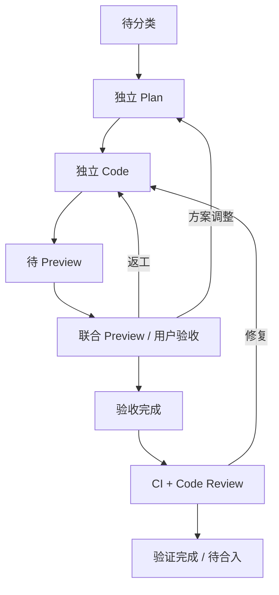
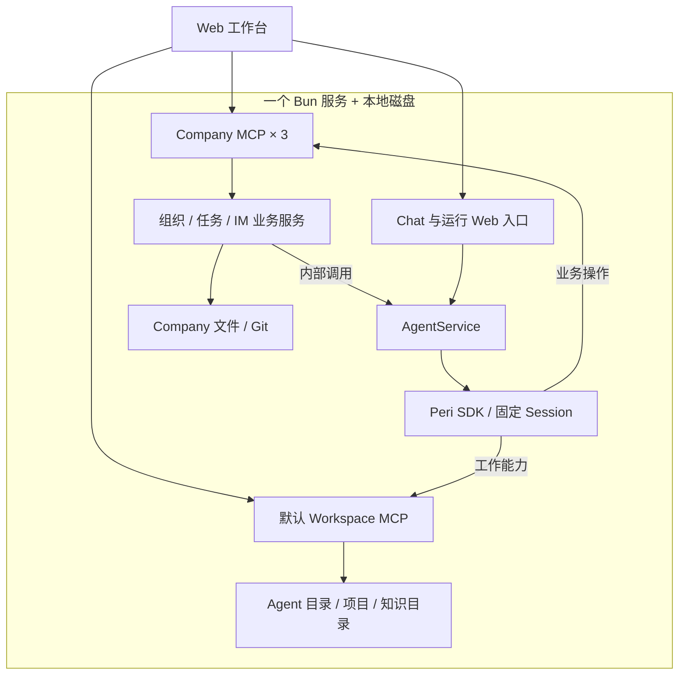

# Company 软件工厂一期实现任务书

请依据本任务书实现 Company 软件工厂一期，完成真实前后端接入、主要业务流程和验收，交付可运行源码、启动说明及验证结果。

本文已合并组织与任务设计 v0.9、系统架构 v0.9 和用户最新裁定。正文可独立作为实现输入；末尾保留原稿及技术参考。已裁定的组织、职责和部署边界直接执行，具体库版本和 Peri SDK 接入方式以实施时的真实接口为准。

当前完成的是设计与交互原型。真实后端、React 组件、Peri、默认 Workspace、Forgejo 等尚未完成产品集成。不要将原型中的模拟行为当成已有实现。

## 1. 目标与一期边界

产品以 **Company → Group → Agent** 组织人员，以平铺 Issue 组织工作。用户选择 Agent，在它的固定会话中交流，并在右侧观察该 Agent 关联的运行、任务、文件和消息。

部署为 **一个 Bun.serve 服务 + 本地磁盘**。使用 Peri SDK 作为执行底座。Company 是组织与业务数据管理层；Agent 创建、会话、唤醒、投递和运行状态由 Company Server 内部管理。

| 项目 | 必须执行的决定 |
| --- | --- |
| 公司初始化 | 创建 Company 时自动建立“总部”，初始化 HR 与任务主管两个正式 Agent |
| 成员归属 | 一个 Agent 只有一个 Company / Group 归属，即一个部门 |
| 组织调整 | 一期不做调组、组织归属调整或离职；这些留到二期 |
| Agent 身份 | 固定 agentId、固定活动目录、固定 sessionId；未唤醒可无实例，唤醒后至多一个实例 |
| 多任务 | 单 Session 多任务交给 Peri multitasks；Subagent 是外包，不纳入 Company 组织管理 |
| 配置 | 界面保存不自动重启或热加载；用户点击“重启”后应用新配置 |
| Issue 创建 | 用户可界面创建；任务主管默认可创建；其他角色需要 issue.create 权限 |
| Issue 评论 | 所有类型、所有阶段的 Issue 都有 Markdown 评论串 |
| 协作与干预 | 复用现有 IM / work 机制，由 Agent 协调任务调整、交接和任务层干预 |
| 软件交付 | 每条 Issue 独立 Plan、Code；联合 Preview；用户验收后 CI + Code Review；通过后待合入 |
| Preview 协调 | 冲突、批次变化、部分通过和返工由 Preview Agent 的提示词处理 |
| 自定义 MCP | 只有 company_org、company_tasks、company_im，采用 mono server 组织 |
| Workspace | 复用 Peri 默认 Workspace MCP 的工具、配置与接入方式 |
| 知识 | 普通 Markdown 文件夹，在 claude.md 标明地址，Agent 自己搜索 |
| 数据 | Company 业务源数据全部是文件；结构化文档用 YAML 头部 + Markdown |
| 外部依赖 | 按高可靠假设；MCP 连接异常属于 P1 事故，不增加业务降级流程 |
| 恢复 | Server 故障恢复、事件重放、跨进程任务续跑暂不设计 |

以下不进入一期：AOS 底座迁移、独立 Agent System MCP、company_files、company_knowledge、自建 Workspace 后端、Company 级 Subagent 调度树、专用知识检索服务、强制知识索引或知识 Skill、复杂组织审批、群聊与全员广播、实际合入与发布流程。

正常文件读写、固定 Session 的加载，以及用户主动重启 Agent 仍需要实现；它们不等于新增故障恢复系统。

## 2. 组织、岗位与初始化

### 2.1 组织模型

| 对象 | 含义 |
| --- | --- |
| Company | 持有总部、部门、花名册、任务库、流水线、知识目录及业务记录 |
| Group | 部门，定义职责与工作范围；总部也是一个 Group |
| Agent | 长期成员，身份与运行资源固定，岗位不决定其 SDK 类型 |
| 花名册 | 通过 agentId 关联唯一部门、岗位与职责 |
| 角色权限 | 记录业务权限，第一期明确支持 issue.create |
| 任务库 | 一个 Company 一份，Issue 平铺存储，按 Agent 查询关联视图 |

创建 Company 时，Company Server 内部完成：

1. 建立公司目录和 Git 管理。
2. 建立“总部”部门。
3. 初始化 HR Agent、任务主管 Agent 的身份、目录、记忆、能力配置和固定 Session。
4. 写入公司花名册。任务主管默认具有 issue.create。
5. 在组织树显示两个成员。空闲时不显示状态文字。

初始化不依赖已有 HR。之后的成员由 HR 通过 company_org 提交定义，再由 Server 内部创建。成员创建时确定唯一部门，一期不提供调组、离职入口。

### 2.2 岗位职责

| 岗位 | 职责 |
| --- | --- |
| HR | 与用户讨论工作目标、职责、能力、部门和交付要求，创建正式 Agent |
| 任务主管 | 创建或接收 Issue，分类、选择流水线、指派和协调交接 |
| Dev | 独立推进 Issue 的计划和代码，修正文档、状态及进度，提交结果 |
| Preview | 聚合多个 Issue，管理本地 Preview 分支和 Dev 环境，组织逐 Issue 验收 |
| Review / 验证岗位 | 按 workflow 执行验收后的 CI、Code Review，记录结论 |
| 其他角色 | 按定义工作；取得 issue.create 权限后可创建 Issue |

岗位可以按 workflow 兼任，系统不强制换一个正式 Agent 才能 Review。HR 和任务主管也是普通正式 Agent，使用相同的 Peri、会话与记忆机制。

HR 的交付是一名可工作的正式成员，不增加“待就绪审批”阶段。任务分派和部门调整分别处理：一期保留任务分派与交接，不因此开放调组。

## 3. Agent、Session、记忆与配置

### 3.1 固定身份

`agentId → ~/.company/agents/<agent-id>/ → 固定 sessionId → 至多一个存活实例`。

- 活动目录不随 Issue 改变。
- 用户从不同 Issue 进入同一 Agent，仍使用原 Session。
- 每个软件 Issue 保留独立 Plan、代码和 worktree。
- 一个正式 Agent 可以负责多个 Issue；执行交给 Peri multitasks。
- 外包不自动产生正式 Agent、组织节点或公司子 Issue。
- Company 只接收正式 Agent 汇总后的业务结果和运行摘要。

Agent 文件使用 Git，只忽略编程依赖目录；`.env`、依赖清单、锁文件等都纳入管控。项目代码按项目仓库提交，Agent 个人资料与项目代码各自保留版本历史。

### 3.2 个人记忆

每个 Agent 有 `claude.md`，初始化为持续学习的记忆存储。遇到问题时先记录现象、已知事实、当前假设和下一步验证，执行 Git commit，再继续工作；验证后修正结论。待验证内容要标明，详细记录可引用 Issue 和 Session。

该规则属于 Agent 工作指导。Company 不增加记忆审批或另一套知识系统。

### 3.3 保存配置与手动重启

| 操作 | 行为 |
| --- | --- |
| 初次创建 | 装配初始配置，建立固定 Session |
| 保存配置 | 保存岗位说明、模型、MCP 等配置；不打断实例，不热加载 |
| 普通休眠 / 唤醒 | 继续使用原已生效配置，不作为自动应用新配置的方式 |
| 用户点击“重启” | Server 内部重新装配已保存配置，沿用原 agentId、目录、sessionId |
| 自学习记忆更新 | 正常读写文件与提交，不因文件变化自动重启实例 |

配置页可显示“配置已保存，重启后生效”，提供独立重启按钮。重启与正在执行工作的衔接复用 Peri / work 的现有行为，不另建 Company 多任务暂停或恢复编排。

## 4. Issue：创建、流转、评论与裁定

### 4.1 创建入口和权限

| 发起方 | 创建规则 |
| --- | --- |
| 用户 | 在当前 Company 的界面点击 Create Issue |
| 任务主管 | 默认拥有 issue.create，经 company_tasks 创建 |
| 其他 Agent | 所属角色被授予 issue.create 才能创建 |
| 普通聊天、IM、文件讨论 | 不自动建单，由有权限的参与者明确执行创建 |

权限由 Server 根据真实调用身份和 Company 角色配置判断，不接受模型自报身份。没有创建权限返回 forbidden，不生成任务文件。角色权限保存在 Company 配置，花名册引用岗位或角色。

创建后的 Issue 默认进入 triage，负责人为任务主管。创建者不自动成为执行负责人。主管补齐目标、分类、匹配流水线并指派。

### 4.2 平铺任务

每条 Issue 在任一时刻有一个业务状态和一个当前责任人。Plan、Code、Preview、验证均是同一 Issue 的阶段，不拆成阶段子任务树。可以保存依赖与关联。

等待用户、CI 或进入 Preview 时，当前责任人继续跟进。没有流程或人员时仍保留负责人，记录原因；需要用户裁定时提出具体问题。

Dev 可以根据实际要求直接修正需求、计划、验收清单、相关文档、状态和进度，无需再次审批。跨人员分派由任务主管处理。任务层干预和交接由 Agent 经 IM / work 协调，Company 保存结果。

当前负责 Agent 可以直接标记 cancel，记录原因并协调其外包工作。既有成果保留，迟到结果不能自动复活任务。

### 4.3 Issue 文件

路径：`~/.company/companys/<company-id>/tasks/<issue-id>.md`。

```markdown
---
id: 42
title: 退款接口
type: software-change
pipeline: software-delivery
status: code
agent_id: dev-order-01
summary: 实现订单退款接口
progress: "8/10 个实现项已完成"
needs_user: true
decisions:
  - id: "42-Q1"
    status: pending
    question: "本期是否支持部分退款？"
    answer: null
preview_batch: null
forgejo_issue: null
---

## 目标与验收要求
提供整单退款能力，明确退款状态和账务处理结果。

## 工作记录
引用独立计划、代码提交、工作记录与自检结果。

## 交付物
引用 Preview、验收清单、CI 和 Code Review 结论。
```

| 字段 | 维护规则 |
| --- | --- |
| id | 公司内唯一，稳定不变 |
| title / summary / progress | 当前责任人维护；progress 是自定义提示文本 |
| type / pipeline / agent_id | 任务主管维护分类、流程和负责人 |
| status | 当前责任人按工作结果修正，主管负责交接安排 |
| decisions / needs_user | 按具体问题记录，存在 pending 就显示待用户裁定 |
| preview_batch | Preview Agent 维护关联，主管接续分派 |
| forgejo_issue | 关联外部 Issue，可为空 |

分类前 type、pipeline 可为空，状态为 triage。进度按当前阶段解释，例如“3/5 个问题已明确”“8/10 个实现项已完成”；阶段通过依据交付条件，不根据进度文本自动推断。

### 4.4 所有 Issue 都有评论

Issue 详情为“描述 + 评论时间线”。所有类型、所有阶段都可使用，用户与相关 Agent 可发表 Markdown 评论、查看历史、编辑自己的评论。评论参与权限不等于 issue.create。

评论可记录讨论、进展、问答、交接、验收意见、代码提交、CI / Review 证据和资料引用。正式状态和负责人仍保存在 Issue 头部；普通评论不自动切换状态。

路径：`comments/<issue-id>/<comment-id>.md`，作者、编号和时间由 Server 填写：

```markdown
---
id: "42-C1"
issue_id: 42
author_type: agent
author_id: preview-01
created_at: "2026-10-30T15:20:00+08:00"
---
#42 本轮验收通过，关联代码与验收清单见下方引用。
```

编辑可记录 updated_at。评论由 company_tasks 提供，不新增评论 MCP 或消息系统。通知与后续协作复用 IM / work。

### 4.5 用户裁定

每个问题有稳定编号，例如 `42-Q1`，状态为 pending、answered、withdrawn。新增问题使用新编号，原问题和回答留存；撤回问题的晚到答复只留历史。

用户通过具体问题入口作答时携带 issueId + questionId。指向不明确的“同意”不得应用到其他问题。答复先写入业务记录，经当前 Agent 处理并标记 answered 后重新计算 needs_user；还有 pending 问题就继续黄色提示，不必等后续开发完成才清除已解决问题。

业务裁定、普通聊天和 Peri 运行时交互分别处理。评论也可以承载讨论与明确结论，但不因出现“同意”两个字自动放行。

## 5. 软件交付流水线与 Preview

### 5.1 状态与责任

| 状态 | 当前工作 | 通过依据 |
| --- | --- | --- |
| triage | 任务主管分类、选流程、派单 | 已明确目标和工作安排 |
| plan | 每个 Issue 独立制定计划和验收清单 | 目标、方案、验收条件具备 |
| code | 独立 worktree 编码与必要自检 | 具备 Preview 条件 |
| ready_preview | Preview Agent 安排批次、环境与入口 | 已集成，环境可用 |
| preview | 用户联合体验、逐 Issue 验收 | 用户确认对应验收项通过 |
| accepted | 验收完成，明确待验证代码 | 验收记录齐备 |
| verifying | CI + Code Review | 两项均针对拟交付代码通过 |
| ready_merge | 验证完成、待合入 | 交付与验证记录完整 |
| cancel | 当前负责人终止任务 | 保留原因和已有成果 |



cancel 是通用终止状态，不需要为每个正常状态画一条线。实际合入与发布另行处理，ready_merge 不能展示为已合入。

### 5.2 流水线文件

固定流水线保存在 `pipelines/<pipeline-id>.md`，YAML 头部管理适用类型、阶段、岗位、交付物与流转条件，正文存工作指导。任务主管选择流水线，Agent 按提示词和文件执行；不建设另一套通用工作流引擎。

```markdown
---
id: software-delivery
name: 软件交付
task_types: [software-change, bugfix]
entry: plan
stages:
  plan:
    role: planner
    deliverable: 方案与逐 Issue 验收清单
    pass_when: 目标、方案与验收条件具备
    next: code
    rework: [plan]
  code:
    role: developer
    deliverable: 代码提交与必要自检结果
    pass_when: 实现完成，具备 Preview 条件
    next: ready_preview
    rework: [plan, code]
  ready_preview:
    role: preview
    deliverable: 批次、环境与验收入口
    pass_when: 已集成，环境可用
    next: preview
    rework: [code]
  preview:
    role: preview
    deliverable: 用户验收记录
    pass_when: 用户确认对应验收项通过
    next: accepted
    rework: [plan, code]
  accepted:
    role: reviewer
    deliverable: 验收结论与待验证代码范围
    pass_when: 验收记录齐备，开始验证
    next: verifying
    rework: [preview]
  verifying:
    role: reviewer
    deliverable: CI 与 Code Review 结论
    pass_when: 对拟交付代码的两项验证均通过
    next: ready_merge
    rework: [code]
  ready_merge:
    role: task-supervisor
    deliverable: 可合入代码与完整验收验证记录
    terminal: true
---

## 工作指导
每个 Issue 独立 Plan 和 Code。
多个 Issue 可进入一个本地 Preview 批次。
用户验收后执行正式 CI 与 Code Review。
变更影响、返工、批次调整由 Preview Agent 依据提示词协调。
```

调整流水线是明确的流程变更，正在执行的任务不应无提示地更换规程。是否独立 Reviewer、谁兼任等由具体 workflow 决定。

### 5.3 Preview 工作方式

Preview Agent 使用默认 Workspace 完成 Git 合并、启动本地 Dev 环境。Company 保存 `previews/<batch-id>.md`，记录负责人、Issue 列表、分支/代码依据、环境入口、验收清单和验证引用。

- 多个 Issue 共用环境，但各自保留状态、验收项与评论。
- Preview 提供用户可访问入口和逐 Issue 的验收清单。
- 部分通过、返工、加入/移出批次、合并与依赖冲突，由 Preview Agent 处理。
- 代码变化后，由它判断需要重新验收或验证的范围，并更新记录。
- 验收、CI、Review 结论关联对应代码；不把历史结论当作当前结论。
- 不增加强制冻结、强制拆批、固定验收轮次或额外审批。
- Preview 页面只展示当前 Agent 负责或明确关联的批次。

Preview 岗位初始化提示词必须覆盖这些责任。用户验收完成和验证完成分别记录，运行结束不自动表示通过。

## 6. 知识、文件与数据归属

### 6.1 公司知识

公司知识就是普通文件夹：

`~/.company/companys/<company-id>/knowledgebase/`

直接放 Markdown，不要求固定分类、INDEX、知识状态 Schema、专用 Skill 或发布流程。初始化 Agent 时，在 claude.md 写入实际公司地址：

```markdown
## 公司知识
知识目录：~/.company/companys/acme/knowledgebase/
遇到领域问题时，先自行搜索该目录中的 Markdown，再按需阅读。
个人经验记录在当前 claude.md；可复用公司知识整理到上述目录。
任务状态、分派、问题和验收通过 Company MCP 修改。
```

默认 Workspace 的可用文件范围包含该知识目录，Agent 活动根仍是个人目录。共享资料通过引用关联，不复制成各 Agent 的独立事实来源。

### 6.2 目录与源数据

| 根 / 路径 | 内容 |
| --- | --- |
| `~/.company/agents/<agent-id>/agent.yaml` | 身份、固定 Session、基础配置 |
| 同目录 `claude.md` | 个人学习记忆、岗位工作指导、公司知识路径 |
| 同目录 `.mcp.json` | 默认 Workspace 与获授权 Company / 外部 MCP 配置 |
| 同目录 `.env` | 环境配置，纳入 Git |
| 同目录 `tasks/<issue-key>/` | 独立计划、执行资料、worktree 引用 |
| `~/.company/companys/<company-id>/company.yaml` | 公司身份、目标、任务库、角色权限 |
| 同目录 `groups.yaml` | 部门，含默认总部 |
| 同目录 `roster.yaml` | agentId、唯一部门、岗位关联 |
| 同目录 `tasks/<issue-id>.md` | Issue 元数据与描述 |
| 同目录 `comments/<issue-id>/<comment-id>.md` | 评论 |
| 同目录 `pipelines/<pipeline-id>.md` | 固定流程 |
| 同目录 `previews/<batch-id>.md` | 联合环境、验收与验证记录 |
| 同目录 `knowledgebase/` | 普通知识 Markdown |
| 同目录 `im/threads/<thread-id>.md` | 话题参与人、状态与引用 |
| 同目录 `im/messages/<message-id>.md` | 消息头部与正文 |
| 同目录必要的事件记录 | 记录工作引用与投递结果；不扩展成恢复系统 |
| 本地 Peri Store | 会话与 Peri 内部执行记录，通过同宿主适配管理 |
| 项目 Git 仓库 | 业务代码、Issue worktree、Preview 分支 |

保留 `companys` 这一目录拼写。Company、Agent 个人目录和项目代码按各自仓库保留 Git 历史。

Company 业务事实以文件为源，不另建一套公司业务数据库。Peri 会话存储属于运行时数据，允许通过现有 Store 接口适配本地磁盘，不能把该选择扩展成 Company 业务表迁移。

### 6.3 正常写入边界

组织、任务、问题、验收、评论和 IM 通过对应业务服务修改。个人执行资料、知识与普通文件通过默认 Workspace 使用。

业务写入按当前职责和文件版本修改指定字段或正文段，保留其他人的有效变更，不拿旧文件整份覆盖。保留基本身份、版本与幂等检查；不新增 assignment_rev 驱动的交接调度机制。

旧成果可保留为评论或证据，由现任 Agent 决定是否采用。Agent 协调交接和晚到结果，Company 不接管外包内部执行。

Forgejo 保留 Git 托管及关联 Issue 入口。任务展示映射 Company 文件，外部有效更新转成业务操作写回文件；不形成两份独立维护的任务状态。

## 7. MCP 清单与调用关系

### 7.1 仅三个自定义 MCP

| MCP | 入口 | 职责 |
| --- | --- | --- |
| company_org | `/company_org/mcp` | Company、部门、花名册、角色权限、HR 提交创建请求 |
| company_tasks | `/company_tasks/mcp` | Issue 创建、描述、评论、分派、流水线、问题、Preview、验收、验证、cancel |
| company_im | `/company_im/mcp` | 同组织成员发现、点对点问答、收件箱、话题 |
| 默认 Workspace | 沿用 Peri 默认配置 | 文件、搜索、执行、技能及既有工作能力 |

三个自定义入口由一个 Bun 服务按 mono 形式挂载，人数增加不增加 MCP 服务数量。默认 Workspace 保留自身实际传输与配置，不硬编码新的 Company 专属 Workspace URL。

**Agent System 是 Server 内部模块。** 不提供 agent_system MCP，不写入 Agent 的 .mcp.json。company_files、company_knowledge 已删除，不通过重命名重新引入。

Issue 评论、Preview 和流程是 company_tasks 的业务用例，不另拆 MCP。MCP 协议 Tasks、Peri 内部任务和 Company Issue 是不同对象。

### 7.2 架构关系



| 调用 | 处理方式 |
| --- | --- |
| HR 创建成员 | HR → company_org → OrganizationService → 内部 AgentService |
| 用户 / Agent 创建或修改 Issue | company_tasks → 业务服务 → 文件与 Git |
| Agent 询问同事 | company_im 落盘 → 内部 IM / work 投递 → 对方原 Session |
| 普通 Chat 输入、停止、运行时回答 | Server 自有 Web 入口 → 内部 AgentService → Peri |
| 文件编辑与知识搜索 | 默认 Workspace，前端仅做视图适配 |
| 公司业务更新 | Company MCP 提供资源读取与在线订阅 |
| 会话和运行更新 | Server 的 Web 展示适配读取 Peri 事实，不新增运行 MCP |

Company Server 内部服务通过普通 TypeScript interface 调用。保持 agentId 软耦合，不让公司业务代码持有散落的 SDK 临时句柄。

## 8. Agent 间沟通与 work

company_im 支持同一 Company 的成员发现，允许跨部门询问。发现结果提供身份、岗位、职责和必要运行摘要，不公开对方私人 Session 或个人目录。

| 工具建议名 | 语义 |
| --- | --- |
| members | 按身份、岗位或职责查找同公司成员 |
| ask | 发起或续接点对点询问，返回 threadId、messageId |
| reply | 回复明确的话题与消息 |
| inbox | 查看自己的消息 |
| thread | 按 cursor 查看参与话题 |
| close | 提问方标记 resolved 或 withdrawn，保留历史 |

以上为 company_im 下的应用工具名，不新增 MCP 协议方法。

消息先保存文件，再通过 Server 内部 IM / work 机制交给目标 Agent。已有实例复用原实例，休眠时按需唤醒固定 Session。接收方可通过 Company MCP 读取消息原文；发送方不等待对方推理，可继续其他工作。

保留以下含义：

- 消息已保存、已送入会话、已回复是不同状态。
- IM 询问不自动创建 Issue、不修改负责人、不创建新 Session。
- IM threadId 和 Peri sessionId 不混用。
- 同事回复不等于用户裁定，也不自动通过验收。
- Issue 转交后，原消息仍保留原参与者；后续协调由 Agent 处理。
- 重复请求按稳定编号去重；关闭话题的迟到回复留作历史，不自动重开。
- 任务调整、交接、用户任务干预及多任务协作复用 IM / work，不另建协调状态机。

这里的 work 指既有工作投递与协作机制，不新增 work MCP。一期不设计群聊、全员广播、离职接任或消息故障恢复系统。

## 9. Interface 优先的模块设计

每个接口在实现前写清输入、输出、调用身份、前置条件、业务变化、错误、事件与正常并发写入规则。接口不仅是函数名；具体实现必须保留这些业务含义。

| 内部接口 / 模块 | 必须覆盖的业务 |
| --- | --- |
| OrganizationService | Company 初始化、总部与两个默认 Agent、部门创建、HR 创建成员、单部门约束、角色权限 |
| IssueService | create 权限、Issue 查询与修改、分类/流程/指派、cancel、评论读取/发表/编辑 |
| DecisionService | 明确问题编号、答复、撤回、历史与 needs_user |
| PreviewService | 批次、分支/代码引用、环境入口、逐 Issue 验收与验证记录 |
| CompanyIM | 同事发现、问答、消息与话题 |
| AgentService | 创建、保存配置、手动重启、固定 Session、投递、运行和会话展示 |
| AgentRuntimePort | Peri SDK 适配；复用单实例和 multitasks，不再实现一个 runtime |
| SessionStorePort | 会话基本读写的本地适配，不负责新的恢复编排 |
| AgentWorkspaceQuery | 按选定 Agent 查询关联业务资料 |
| WorkspaceViewAdapter | 将文件树、编辑、Diff、引用交互映射到默认 Workspace |
| PeriChatViewAdapter | 将实际会话与运行数据映射成 UI 消息、工具活动和引用 |
| CompanyStore / GitPort | YAML + Markdown 的正常读写、版本与 Git 操作 |
| EventDeliveryPort | 业务落盘后的现有 IM / work 投递 |
| McpModuleRegistry | 三个 Company 入口、可信请求上下文和 mono 路由 |

业务接口形状示意如下；这是 Company 的内部契约，不声称这些方法就是 Peri SDK 的公开 API：

```ts
type AgentScope = Readonly<{ companyId: string; agentId: string }>;

interface OrganizationService {
  createCompany(context: CallerContext, input: CreateCompanyInput): Promise<CompanySnapshot>;
  createGroup(context: CallerContext, input: CreateGroupInput): Promise<GroupSnapshot>;
  createMember(context: CallerContext, input: CreateMemberInput): Promise<MemberSnapshot>;
}

interface IssueService {
  create(context: CallerContext, input: CreateIssueInput): Promise<IssueSnapshot>;
  update(context: CallerContext, input: UpdateIssueInput): Promise<IssueSnapshot>;
  assign(context: CallerContext, input: AssignIssueInput): Promise<IssueSnapshot>;
  comments(context: CallerContext, issueId: string, cursor?: string): Promise<CommentPage>;
  addComment(context: CallerContext, input: AddCommentInput): Promise<IssueComment>;
  updateComment(context: CallerContext, input: UpdateOwnCommentInput): Promise<IssueComment>;
}

interface AgentService {
  provision(context: CallerContext, input: CreateAgentInput): Promise<AgentBinding>;
  saveConfiguration(context: CallerContext, input: SaveAgentConfigInput): Promise<AgentConfigReceipt>;
  restart(context: CallerContext, scope: AgentScope): Promise<AgentRuntimeSnapshot>;
  deliver(context: CallerContext, input: DeliveryInput): Promise<DeliveryReceipt>;
  snapshot(context: CallerContext, scope: AgentScope): Promise<AgentRuntimeSnapshot>;
  conversation(context: CallerContext, scope: AgentScope, cursor?: string): Promise<ConversationPage>;
}

interface AgentWorkspaceQuery {
  snapshot(context: CallerContext, scope: AgentScope): Promise<AgentWorkspace>;
  changes(context: CallerContext, scope: AgentScope, cursor?: string): AsyncIterable<AgentBusinessEvent>;
}
```

CallerContext / AgentContext 由可信入口构建；目标 agentId 与调用者身份分别表达。查询、缓存、订阅、文件缓冲、分页结果携带 companyId + agentId，切换成员后不得串入旧数据。

基本错误语义保持清楚：无权限为 forbidden，非当前负责人修改其不负责的状态为 not_current_owner，资料版本冲突为 version_conflict，相同请求编号对应不同输入为 idempotency_conflict。这些是正常数据操作约束，不是新增审批和任务编排。

## 10. UI：Agent 为第一维度

### 10.1 主布局

桌面三栏比例 **1:2:3**，可拖动分栏；窄屏按阅读顺序重排。运行中的工作是默认重点，不加入全公司统计看板。

| 区域 | 设计 |
| --- | --- |
| 左侧 1 | Company → Group → Agent；公司是顶层；总部下默认 HR 与任务主管 |
| Agent 行 | 每个 Agent 严格一行；忙碌指示在姓名左侧，空闲留白，不显示在线/休眠文字 |
| 人工裁定 | Agent 姓名或整行轻量黄色；详情进入 Chat / 右侧，不增加第二行 |
| 中间 2 | 当前 Agent 固定 Session，连续正文、工具活动、上下文与紧凑输入框 |
| 右侧 3 | 当前 Agent 的 Data Shell，页签为运行、任务、文件、消息 |

忙碌来自真实运行摘要，包括主会话执行或仍在执行的异步工作。仅有未完成 Issue、等用户或等同事，不自动等于忙碌。Company 不展示外包树。

### 10.2 数据范围与操作

- 切换 Agent，同时切换 Chat 和右侧数据，保留各 Agent 的草稿、文件标签和缓冲。
- 选择 Issue 只变更工作上下文，不开新 Session。
- 任务显示当前负责和明确协作的 Issue；历史交接保留来源，并可进入现任。
- 用户可以 Create Issue；详情支持描述、评论、状态、进度和明确问题作答。
- 主管看到与自己分派、协调有关的工作，不因岗位变成全局监控台。
- 消息显示本人参与的话题；Preview 显示本人负责或工作中引用的批次。
- Agent 配置提供保存与独立重启，保存后展示待重启提示。
- 一期不出现调组、离职、恢复控制台等入口。

### 10.3 Chat 与输入框

中间融合 ChatGPT 的清晰正文阅读、ZCode 的活动组织和 t3code 的输入交互。优先使用开源 React 组件，避免整体移植参考产品的服务与协议。

输入区按“当前 Issue / worktree → 问题或待处理输入 → 引用与正文 → 工具和偏好 → 发送”组织，控制高度。

| 能力 | 要求 |
| --- | --- |
| 流式正文 | Markdown、代码、工具结果和活动可读，稳定滚动 |
| 工具 / 异步活动 | 可展开摘要，不挤占主要回答 |
| @ 文件 / 代码 | 文件引用可打开右侧；选区保留路径、行范围、内容依据 |
| / 命令与技能 | 只展示该 Agent 实际可用的能力 |
| 附件 | 复用默认 Workspace / Peri 已有接入；就绪后才能发送 |
| 输入队列 | 展示 Peri 实际提供的能力，支持时开放编辑/移除；不自建执行调度 |
| 停止回复 | 适配 Peri 控制；任务层调整、取消由 Agent / IM / work 处理 |
| 模型与单次偏好 | 沿用 Agent 默认配置，只开放运行时支持的单次选项 |
| 裁定问题 | 显式携带 Issue / 问题编号，不与普通发送混淆 |
| 历史 | cursor 分页，加载较早消息保留阅读位置 |
| 键盘 | Enter 换行，Cmd/Ctrl+Enter 发送 |

提交时捕获 Agent、Issue / 问题、正文、引用与参数；切换页面不改变已提交内容归属。收到明确回执后清理对应草稿，保留用户后来输入的内容。

停止、队列编辑等控件以 Peri 实际支持为准。不要用假队列、假完成状态或“停止再发送”冒充另一种运行能力。

### 10.4 完整文件工作区

文件页以 Agent 完整活动目录为根，提供 VS Code 风格的目录树、搜索、文件标签、编辑保存、Git 变更与 Diff。

- 展示配置、记忆、.env、执行材料、worktree 和依赖目录；Git ignore 不等于隐藏文件。
- 共享知识等资料以明确的可用根或引用出现。
- 提供“全部文件 / 变更”切换，Diff 显示比较依据。
- Chat 引用打开右侧对应文件与选区，文件选区可引用到 Chat。
- 未保存内容与磁盘外部修改发生冲突时保留双方，提示比较，不静默覆盖。
- 保存、Git commit、阅读标记、评论、验收分别表达，不互相冒充。
- Company 业务状态仍由业务接口修改，文件区不成为绕过职责的写入入口。
- 完整目录能力来自默认 Workspace；Monaco 是编辑器，不承诺完整 VS Code 插件能力。

## 11. 技术栈与接入约束

### 11.1 选型

以下沿用 v0.9 推荐，作为实现默认组合。具体版本和兼容性由实现时核对并锁定；这些推荐不代表已经完成集成。

| 能力 | 选择 |
| --- | --- |
| 后端 | TypeScript + Bun + Hono；单 Bun.serve 托管静态产物、Web 入口和 Company MCP |
| MCP | 复用现有 @peri-code/mcpp 与兼容 MCP 0728 的接入实现 |
| Agent | 当前 Peri SDK，通过 AgentRuntimePort 适配 |
| 文件格式 | Bun / node:fs + yaml Document API，保留 YAML 和 Markdown |
| 数据形状 | Zod；业务规则在应用服务 |
| Git | 系统 Git + simple-git |
| 文件观察 / 搜索 | 默认 Workspace 优先；Company 内部需要时使用 chokidar / rg |
| 会话磁盘 | 嵌入式 SQLite 为优先目标，bun:sqlite 为候选驱动，需适配 Peri Store |
| 前端 | React + TypeScript + Vite |
| UI | Tailwind + shadcn/ui Radix 组件 |
| Chat | AI Elements 模式 + Streamdown，PeriChatViewAdapter 接实际数据 |
| 输入 | Tiptap + React + 自定义引用节点 |
| 文件树 | react-arborist |
| 编辑 / Diff | Monaco + @monaco-editor/react |
| 分栏 | react-resizable-panels |
| 本地 UI 状态 | Zustand |
| 查询缓存 | TanStack Query，key 包含 AgentScope |
| 长消息列表 | 单一滚动 viewport，按需使用 Message Scroller / TanStack Virtual |

Vite 是构建和开发工具，生产部署仍只有一个 Bun 产品服务。Git、Dev、测试等工作进程是工作内容，不增加另一套 Company 后端。不要引入独立数据库服务、消息中间件或 Company 自建 Workspace 服务。

### 11.2 Peri SDK 接入

实施时先核对当前公开导出和实际行为，再写适配器。原设计核对过的快照为：

`283d12db41455b717fa8bd79acbbe068008a2ee5`

该快照使用 `@peri-code/sdk` 的 Chat / Session 入口，不应凭旧 ManagedAgents 示例接入，也不把仓库占位版本当成 npm 最新版本。

需要接通并验证：

1. 创建一次真实 Session，将 sessionId 绑定 agentId；后续进入、唤醒和手动重启沿用此 Session。
2. 配置由 Company 宿主装配，包括 claude.md、岗位、multitasks 指导和 .mcp.json；不能假设 SDK 自动发现这些文件。
3. AgentScope 到实际 Peri 实例、会话视图和输入操作的内部路由。
4. 会话和工具活动展示、历史分页、运行摘要；不让前端直接控制 SDK 临时句柄。
5. 同宿主会话基本读写适配，满足 Bun + 磁盘部署。
6. 默认 Workspace 的实际工具、文件范围、配置和能力展示。

`send().accepted` 一类接收回执不等于 Issue 完成。临时 Chat 句柄不等于固定 sessionId。运行时 answer 不等于 Company 问题裁定。

旧稿已指出会话 Store 进程内磁盘适配需要核验，不能假设安装 SQLite 驱动即完成。若当前 SDK 接口变化，在内部适配层解决并记录依据，不因此改变组织、业务模型或部署边界。

### 11.3 MCP 与通知

按项目采用的 MCP 0728 实现接入。业务身份、Peri sessionId、IM threadId 和消息编号由应用明确管理，不依赖传输连接保存业务身份。

Company 的组织、任务/评论、消息更新使用已有 MCP 资源与订阅方式。订阅通知不承担休眠 Agent 的唤醒；唤醒来自 Server 内部 work 投递。默认 Workspace 沿用既有观察能力，不要求新增 Company 专属协议。

新附件沿用已接入的默认能力。若默认实现支持现有 MCPP 文件上传扩展，按其实际发现和授权方式接入；不为了本项目新增文件 MCP、猜测上传 URL 或宣称未接通的上传能力可用。

## 12. 实现要求与交付物

本任务的目标是完成一期实现，不停在计划、接口空壳或模拟演示。接口与正常业务行为先明确，再接开源实现；无需重新讨论已裁定边界。

目标仓库没有在设计稿中指定。接收环境已有指定工程时在该工程内实现；没有工程时建立独立 Company Factory 工作目录，使用 Peri SDK 作为依赖。记录实际源码位置、依赖版本和启动方式。

交付至少包括：

| 交付 | 内容 |
| --- | --- |
| 源码 | 可运行 Company Server 与 React 工作台；三个 Company MCP、内部 Agent 管理、文件和 Git 接入 |
| 初始化资料 | 总部、HR、任务主管模板；HR 创建其他岗位所需模板；默认软件交付流水线 |
| 工作指导 | 持续学习记忆、multitasks 使用、知识路径、Dev 自主修正、Preview 协调要求 |
| 运行说明 | 安装、配置、构建、启动、数据路径、模型及外部能力配置 |
| 验收示例 | 可重复执行的最小场景与数据，明确其为示例 |
| 验证结果 | 实际命令、结果、关键 UI 证据、真实集成范围及未完成项 |
| 交付形式 | 源码提交或可应用 patch / 源码包；附简明 README |

外部服务或凭据尚未接入时，清楚标记该项未验证，不能用模拟成功充当真实集成通过。不要因为默认 Workspace 或 SDK 具体接口未确认，就另写一套同名替代后端。

## 13. 正向验收清单

以下检查产品集成和用户可见行为；不重复测试 Peri multitasks 的内部算法，不扩展到故障恢复。

| 编号 | 场景 | 通过标准 |
| --- | --- | --- |
| A01 | 创建 Company | 自动出现总部、HR、任务主管；初始化目录、文件、Git 与真实 Session 绑定 |
| A02 | HR 创建 Agent | 根据讨论定义加入一个部门；组织树出现成员；没有调组、离职入口 |
| A03 | 保存与重启 | 保存配置不重启、不热加载；点击重启后应用，agentId / 目录 / sessionId 不变 |
| A04 | 用户与角色建单 | 用户界面、主管、有权限角色可创建；未授权角色返回 forbidden 且不落任务文件 |
| A05 | Issue 文件与评论 | 描述/头部/评论真实落盘；用户和 Agent 可评论、编辑自己的评论，状态与普通评论分别处理 |
| A06 | Agent 范围切换 | 左、中、右同步切换；旧响应不串页；草稿、标签和缓冲按 Agent 保留 |
| A07 | 同 Agent 多 Issue | 从不同 Issue 进入仍为同一 Session；Company 仅对接 Peri，不创建外包组织节点 |
| A08 | 指定问题裁定 | 黄色来源明确，答复关联正确编号；answered 后重新计算，其他 pending 保留 |
| A09 | IM 接入 | 同 Company 可跨部门发现和询问；消息落盘、投递、回复可区分；不创建新 Session 或 Issue |
| A10 | 文件工作区 | 完整目录、搜索、编辑、Diff、代码引用可用；外部修改不静默覆盖未保存草稿 |
| A11 | 知识目录 | claude.md 有实际路径，Agent 能用默认 Workspace 搜索 Markdown；无知识/文件专用 MCP |
| A12 | 软件交付 | 每 Issue 独立 Plan/Code，至少两个 Issue 联合 Preview，逐 Issue 验收及评论证据明确 |
| A13 | 验证与待合入 | 用户验收后正式 CI / Review；两项通过后 ready_merge，不能显示为已合入 |
| A14 | 自主修正与 cancel | Dev 可修正文档和状态；当前负责人可 cancel；协作交给 IM / work，没有新增审批 |
| A15 | MCP 与部署 | 仅三个自定义 Company MCP；Agent System 仅内部；生产为一个 Bun 服务加磁盘 |

验收报告逐项说明“已通过 / 未通过 / 未验证”及依据。对未验证项说明具体缺少的接入或条件，不把其计入已完成。优先修复阻断主流程、数据正确性和关键 UI 的问题。

## 14. 设计来源与技术参考

本任务书的业务范围和裁定已在正文完整整理，不要求接收方重新拼接两个原稿。

| 来源 | 用途 |
| --- | --- |
| [组织与任务设计 v0.9](https://chatgpt.com/library?file_id=libfile_c0b38cf5842c81918e537b835d3a2485&account_id=personal) | 原始业务与 UI 基线 |
| [系统架构 v0.9](https://chatgpt.com/library?file_id=libfile_690fc746820c8191981a157eff5dff43&account_id=personal) | 原始模块、接口和技术选型基线 |
| [Peri 源码](https://github.com/KonghaYao/peri) | 实施时核对当前 SDK 与 Workspace |
| [已核对快照的 SDK README](https://github.com/KonghaYao/peri/blob/283d12db41455b717fa8bd79acbbe068008a2ee5/npm-packages/@peri-sdk/README.md) | 历史接入依据，不代表当前版本已完成产品适配 |
| [已核对快照的 Chat 类型](https://github.com/KonghaYao/peri/blob/283d12db41455b717fa8bd79acbbe068008a2ee5/npm-packages/@peri-sdk/src/chat/types.ts) | Session / Chat / Store 参考 |
| [已核对快照的 multitask Skill](https://github.com/KonghaYao/peri/blob/283d12db41455b717fa8bd79acbbe068008a2ee5/mcp-packages/workspace/src/resources/builtin/skills/multitask/SKILL.md) | 复用多任务工作方式 |
| [现有 mono MCP 注册实现](https://github.com/KonghaYao/mcp-skills-registry) | 复用入口聚合形态 |
| [ZCode](https://github.com/zai-org/ZCode) | 消息与活动、文件工作区交互参考 |
| [t3code](https://github.com/pingdotgg/t3code) | 输入框、上下文、队列和变更视图参考 |
| [shadcn/ui AI Elements](https://ui.shadcn.com/docs/ai-elements) | 推荐 Chat 展示组件入口 |
| [Tiptap React](https://tiptap.dev/docs/editor/getting-started/install/react) | 输入编辑器参考 |
| [Monaco](https://github.com/microsoft/monaco-editor) | 代码编辑与 Diff 参考 |

以上源码与文档链接来自已有设计稿；本次为设计整合，没有重新执行 SDK / UI 库的集成验证。最终实现记录实际使用版本与测试结果。

